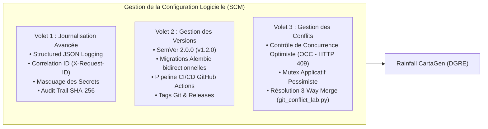

# Rainfall CartaGen — Plateforme Hydrologique & Cartographique DGRE

[](https://github.com/dhieeddine/carta_gen/actions/workflows/ci.yml)
[](https://semver.org/spec/v2.0.0.html)
[](docs/RAPPORT_ARCHITECTURE_SCM_SUJET10.md)
[-brightgreen.svg)](tests/test_scm_features.py)
[](alembic.ini)
[](cartagen/infrastructure/logging/audit_logger.py)

**Rainfall CartaGen** est une plateforme hydrologique et géospatiale intelligente développée pour la Direction Générale des Ressources en Eau (DGRE - Ministère de l'Agriculture, Tunisie), combinant une architecture logicielle hexagonale, un système multi-agents autonome, un modèle de langage fine-tuné (QLoRA) et un RAG vectoriel géospatial sous PostgreSQL/PostGIS. Conçue pour remplacer un processus manuel historique de 7 à 8 mois, elle automatise l'exploitation des données pluviométriques des 148 stations nationales de référence, assurant l'interrogation en langage naturel, la génération dynamique de cartes thématiques 300 DPI (isohyètes annuelles, panneaux 4 saisons, anomalies par rapport à la normale 50 ans), l'ingestion automatisée des bases historiques Microsoft Access (.mdb) et la compilation complète des Annuaires Pluviométriques nationaux en formats bimodaux Word (.docx) et PDF en moins de 3 minutes par campagne.

---

## 🏛️ Gestion de la Configuration Logicielle (SCM — Sujet 10)

Cette plateforme intègre une implémentation complète et rigoureuse des standards de **Gestion de la Configuration Logicielle (SCM)** conformes aux normes **IEEE 828** et **ISO/IEC 12207** articulée autour de 3 volets fondamentaux :



| Volet SCM | Implémentation Architecturale & Composants | Localisation dans le Dépôt |
| :--- | :--- | :--- |
| **Volet 1 : Journalisation Avancée** | • **Structured JSON Logger** avec horodatage ISO 8601 et contexte agent.<br>• **Middleware ASGI Correlation ID** propageant `X-Request-ID` via `ContextVar`.<br>• **Filtre regex de masquage** automatique des clés sensibles (`HF_TOKEN`, mots de passe).<br>• **Piste d'Audit immuable** (`logs/audit_trail.jsonl`) signée par **empreinte SHA-256 déterministe**. | [`cartagen/infrastructure/logging/`](cartagen/infrastructure/logging/)<br>[`cartagen/infrastructure/logging/audit_logger.py`](cartagen/infrastructure/logging/audit_logger.py)<br>[`cartagen/infrastructure/logging/middleware.py`](cartagen/infrastructure/logging/middleware.py) |
| **Volet 2 : Gestion des Versions** | • **Semantic Versioning 2.0.0** (`cartagen/version.py`, endpoint `GET /api/v1/version`).<br>• **Versioning du schéma PostgreSQL/PostGIS** avec migrations Alembic réversibles (`upgrade`/`downgrade`).<br>• **Tags Git & GitHub Releases** (`v1.2.0`).<br>• **Pipeline CI/CD GitHub Actions** automatisant linting, migrations, tests et dry-run Docker. | [`cartagen/version.py`](cartagen/version.py)<br>[`alembic.ini`](alembic.ini)<br>[`cartagen/infrastructure/database/migrations/`](cartagen/infrastructure/database/migrations/)<br>[`.github/workflows/ci.yml`](.github/workflows/ci.yml) |
| **Volet 3 : Gestion des Conflits** | • **Optimistic Concurrency Control (OCC)** : détection du *Lost Update* via `version_id` et rejet avec statut **HTTP 409 Conflict**.<br>• **Mutex Applicatif Pessimiste** (`TaskMutexManager`) protégeant les traitements longs (compilation annuaire).<br>• **Simulateur de Conflits Git** interactif démontrant le *3-Way Merge* et sa résolution. | [`cartagen/infrastructure/concurrency/optimistic_lock.py`](cartagen/infrastructure/concurrency/optimistic_lock.py)<br>[`cartagen/infrastructure/concurrency/pessimistic_lock.py`](cartagen/infrastructure/concurrency/pessimistic_lock.py)<br>[`git_conflict_lab.py`](git_conflict_lab.py) |

### 📚 Dossiers & Guides SCM Documentaires
- 📄 **Rapport Académique Complet :** [`docs/RAPPORT_ARCHITECTURE_SCM_SUJET10.md`](docs/RAPPORT_ARCHITECTURE_SCM_SUJET10.md)
- 🧪 **Protocole de Vérification Manuelle Pas-à-Pas :** [`docs/GUIDE_VERIFICATION_MANUELLE_SCM.md`](docs/GUIDE_VERIFICATION_MANUELLE_SCM.md)
- 🎬 **Scénario & Script de Tournage Démo Vidéo :** [`docs/SCENARIO_DEMO_VIDEO_SCM.md`](docs/SCENARIO_DEMO_VIDEO_SCM.md)
- 🧪 **Suite de Tests SCM Automatisés (26 tests, 100% succès) :** [`tests/test_scm_features.py`](tests/test_scm_features.py)

---

---

## Quick Start (Démarrage Rapide)

### Option 1 : Lancement Local (Python)

1. **Cloner le projet et créer l'environnement virtuel :**
   ```bash
   cd carta_gen
   python -m venv venv
   ```
   - Sur Windows : `.\venv\Scripts\activate`
   - Sur Linux / macOS : `source venv/bin/activate`

2. **Installer les dépendances :**
   ```bash
   pip install -r requirements.txt
   ```

3. **Initialiser la configuration :**
   ```bash
   cp .env.example .env
   # Renseignez vos clés API (GROQ_API_KEY ou OPENAI_API_KEY) et votre connexion DATABASE_URL dans .env
   ```

4. **Lancer le serveur :**
   ```bash
   python run_app.py
   ```
   L'application est accessible sur : **http://localhost:8000** (Swagger UI sur **http://localhost:8000/docs**).

---

### Option 2 : Lancement Conteneurisé (Docker Compose)

Démarre l'application FastAPI ainsi que la base de données PostgreSQL/PostGIS 15 dans des conteneurs isolés avec volumes persistants :

```bash
docker compose up -d --build
```
- Serveur Web & API : **http://localhost:8000**
- Base PostgreSQL / PostGIS : **localhost:5432**

---

## Référence des Endpoints de l'API (Intégration Externe)

L'API REST est exposée à la racine `http://localhost:8000`. Tous les échanges de données s'effectuent en `application/json` (sauf téléversement de fichiers en `multipart/form-data`).

### 1. Annuaires Hydrologiques (Génération Bimodale PDF & Word)

#### `POST /api/v1/yearbook/generate`
Déclenche la compilation asynchrone d'un annuaire pluviométrique complet (50+ pages avec tableaux mensuels, calculs statistiques et cartes).
- **Corps de la requête (JSON) :**
  ```json
  {
    "year": 2021,
    "gouv": "all",
    "format": "docx"
  }
  ```
  - `year` *(int, obligatoire)* : Année de début de la campagne agricole (ex: `2021` pour 2021-2022).
  - `gouv` *(string, obligatoire)* : `"all"` pour l'annuaire national complet, ou le nom du gouvernorat (ex: `"Tunis"`, `"Jendouba"`).
  - `format` *(string, optionnel)* : Format cible : `"docx"` (Word éditable) ou `"pdf"` (PDF natif). Défaut : `"pdf"`.
- **Réponse (200 OK) :**
  ```json
  {
    "status": "queued",
    "request_id": "yearbook_all_2021_1712345678",
    "format": "docx",
    "message": "Génération de l'annuaire en format DOCX initiée."
  }
  ```

#### `GET /api/v1/maps/status/{request_id}`
Consulte l'état d'avancement d'une tâche asynchrone (annuaire ou cartographie).
- **Paramètre d'URL :** `request_id` *(string)*.
- **Réponse en cours (200 OK) :**
  ```json
  {
    "status": "processing"
  }
  ```
- **Réponse terminée (200 OK) :**
  ```json
  {
    "status": "completed",
    "format": "docx",
    "file_url": "/api/v1/yearbook/download/annuaire_all_2021.docx",
    "docx_url": "/api/v1/yearbook/download/annuaire_all_2021.docx",
    "pdf_url": "/api/v1/yearbook/download/annuaire_all_2021.pdf",
    "execution_time": 45.2
  }
  ```

#### `GET /api/v1/yearbook/download/{filename}`
Télécharge le fichier d'annuaire généré (`.docx` ou `.pdf`).
- **Paramètre d'URL :** `filename` *(string)* (ex: `annuaire_all_2021.docx`).
- **Réponse :** Fichier binaire en téléchargement direct (`application/vnd.openxmlformats-officedocument.wordprocessingml.document` ou `application/pdf`).

---

### 2. Chat Pluviométrique & RAG Sémantique

#### `POST /api/v1/annuaire/chat`
Pose une question hydrologique en langage naturel (français ou anglais).
- **Corps de la requête (JSON) :**
  ```json
  {
    "question": "Quel est le cumul annuel à Ain Draham en 2021-2022 et l'écart à la normale ?",
    "llm_provider": "groq",
    "use_rag": true
  }
  ```
  - `question` *(string, obligatoire)* : Question posée en langage naturel.
  - `llm_provider` *(string, optionnel)* : Fournisseur LLM (`"groq"`, `"openai"`, `"ollama"`, etc. — prend la valeur par défaut du `.env` si omis).
  - `use_rag` *(bool, optionnel)* : Active ou désactive la recherche vectorielle sémantique (`true` par défaut).
- **Réponse (200 OK) :**
  ```json
  {
    "status": "queued",
    "request_id": "chat_rag_1712345678"
  }
  ```
  *Note : Le résultat complet (réponse rédigée `answer`, tableau `table_html`, `sources`, `images` et `agent_traces`) se récupère via `/api/v1/maps/status/{request_id}`.*

#### `POST /api/v1/annuaire/index`
Lance l'indexation sémantique des documents textuels et données de l'annuaire dans la base vectorielle.
- **Réponse (200 OK) :** `{"status": "started", "message": "Indexation démarrée en arrière-plan."}`

#### `GET /api/v1/annuaire/image/{folder_name}/{filename}`
Récupère une figure ou carte stockée associée à un annuaire.

---

### 3. Synthèse Cartographique Multi-Agents

#### `POST /api/v1/maps/generate`
Déclenche la génération d'une carte thématique haute résolution via le workflow multi-agents.
- **Corps de la requête (JSON) :**
  ```json
  {
    "prompt": "Générer la carte des isohyètes annuelles de la Tunisie 2020-2021",
    "llm_provider": "groq",
    "use_rag": true
  }
  ```
- **Réponse (200 OK) :** `{"status": "queued", "request_id": "map_req_1712345678"}`

#### `GET /api/v1/maps/image/{filename}`
Récupère l'image PNG haute définition (300 DPI) générée.
- **Paramètre d'URL :** `filename` *(string)* (ex: `isohyete_2020_2021.png`).

---

### 4. Ingestion et Migration des Données Spatiales

#### `POST /api/v1/data/ingest-mdb`
Téléverse et migre une base de données historique Microsoft Access (.mdb / .accdb) vers PostgreSQL/PostGIS.
- **En-tête HTTP :** `Content-Type: multipart/form-data`
- **Form Data :** `file` *(fichier binaire .mdb ou .accdb)*
- **Réponse (200 OK) :**
  ```json
  {
    "success": true,
    "message": "Migration achevée avec succès.",
    "stations_imported": 148,
    "records_imported": 54020
  }
  ```

#### `POST /api/v1/data/ingest-shapefiles`
Synchronise et intègre les shapefiles cartographiques (gouvernorats, délégations, limites hydrographiques) dans la base PostGIS.
- **Réponse (200 OK) :** `{"success": true, "message": "Shapefiles spatiaux ingérés dans PostGIS."}`

---

### 5. Fournisseurs de Modèles LLM (Multi-Provider)

#### `GET /api/v1/providers`
Liste l'ensemble des fournisseurs et modèles LLM enregistrés.
- **Réponse (200 OK) :**
  ```json
  {
    "providers": [
      {
        "id": "groq_llama33",
        "name": "Groq LLaMA 3.3 70B",
        "exec_type": "api_key",
        "model": "llama-3.3-70b-versatile",
        "is_default": true
      }
    ]
  }
  ```

#### `POST /api/v1/providers/add`
Ajoute dynamiquement un nouveau fournisseur ou un tunnel d'inférence (Colab, Kaggle, Ollama local, etc.).
- **Corps de la requête (JSON) :**
  ```json
  {
    "name": "Serveur vLLM Colab",
    "exec_type": "colab",
    "model": "qwen2.5-coder-7b",
    "endpoint_url": "https://xxxx.ngrok-free.app/v1",
    "api_key": ""
  }
  ```

---

### 6. Configuration & Surveillance Système

#### `GET /health`
Sonde de santé système (liveness & readiness probe pour Docker et orchestrateurs).
- **Réponse (200 OK) :** `{"status": "healthy", "service": "cartagen_api"}`

#### `GET /api/v1/config/env`
Retourne la configuration actuelle des variables d'environnement (avec masquage automatique des secrets et mots de passe).

#### `POST /api/v1/config/env`
Met à jour les paramètres de configuration dans le fichier `.env`.
- **Corps de la requête (JSON) :**
  ```json
  {
    "variables": {
      "LLM_PROVIDER": "groq",
      "TEMPERATURE": 0.1
    }
  }
  ```

#### `POST /api/v1/config/test-db`
Valide la connectivité immédiate avec le cluster PostgreSQL/PostGIS.
- **Réponse (200 OK) :** `{"success": true, "message": "Connexion PostgreSQL/PostGIS établie avec succès."}`

#### `POST /api/v1/config/test-llm`
Teste le temps de réponse et la validité du fournisseur LLM sélectionné.
- **Corps de la requête (JSON) :** `{"provider": "groq", "prompt": "Reponds uniquement: OK"}`
- **Réponse (200 OK) :** `{"success": true, "provider": "groq", "latency_ms": 142, "response": "OK"}`
